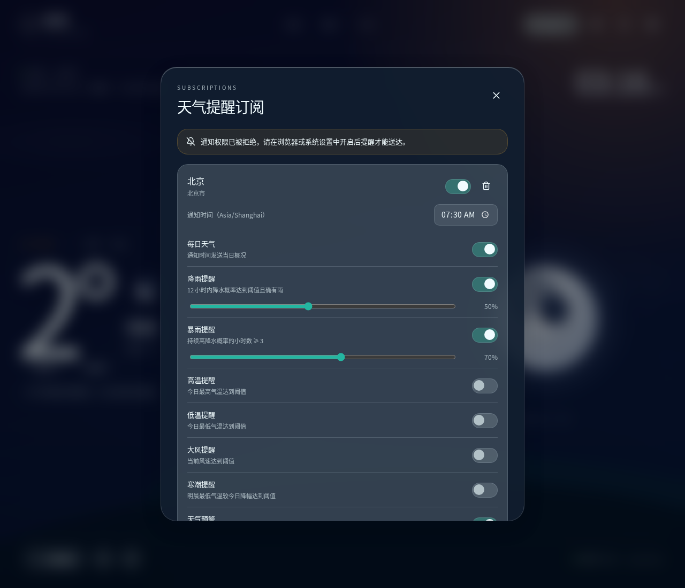
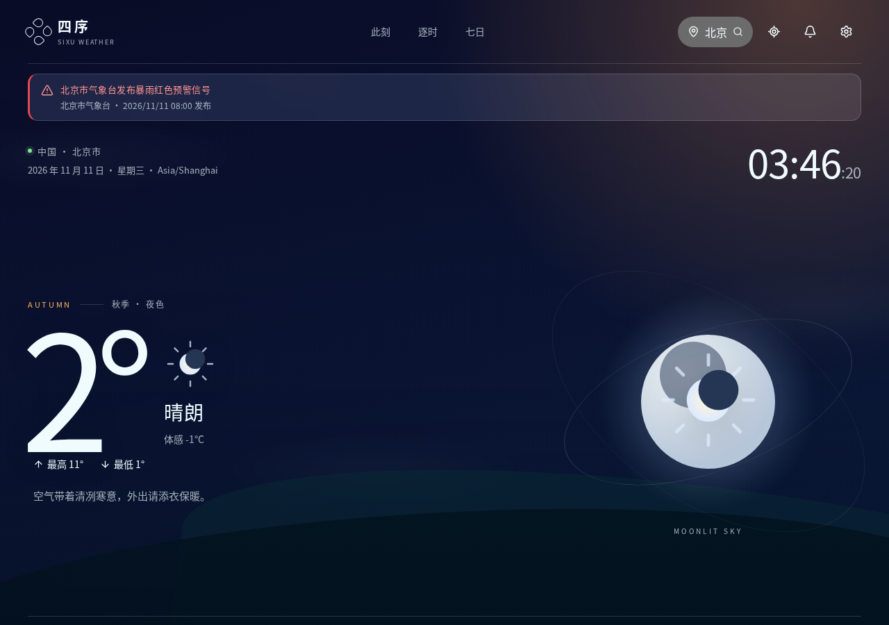

# 阶段 4 交付报告：天气数据、订阅、提醒与通知系统

日期：2026-11-11 ｜ 前置提交：`c7e57a3`（阶段 3）｜ 本阶段提交：见文末

## 一、功能清单

| 功能 | 状态 | 实现位置 |
| --- | --- | --- |
| 实时天气（温度、体感、湿度、气压、云量、降水、能见度、昼夜） | ✅ 既有，本阶段补充阵风 | `src/services/weather/api.ts` |
| 阵风（当前阵风风速） | ✅ 新增 | `CurrentWeather.windGusts`，首页风指标详情展示 |
| 逐小时预报（24 小时：温度、降水概率、天气现象、UV） | ✅ 既有 | `src/pages/HomePage.tsx` |
| 未来多日预报（7 天：高低温、天气现象、降水概率、UV、日出日落） | ✅ 既有 | `src/ui/components/DailyForecast.tsx` |
| 降水概率（逐小时 + 逐日最大） | ✅ 既有 | — |
| 能见度 | ✅ 既有 | — |
| 空气质量（US AQI、PM2.5、PM10、O₃、NO₂、SO₂、CO、首要污染物、六级分级配色） | ✅ 新增 | Open-Meteo Air Quality API（CAMS 模式数据） |
| 日出时间 / 日落时间 | ✅ 修复时区语义并补测试 | `src/domain/solar.ts`、`src/domain/time.ts` |
| 官方天气预警（中央气象台发布，蓝/黄/橙/红四级，按城市/省份匹配，首页横幅展示） | ✅ 新增（nmc.cn 公开接口，方案 B） | `src/services/weather/warnings.ts` + `src/hooks/useWarnings.ts` |
| 数据推导天气提示（无官方预警覆盖时的补充） | ✅ 既有 | `src/domain/alerts.ts` + `src/domain/subscriptions.ts` |
| 日出日落时区逻辑（UTC/本地时区/夏令时/跨日期/极地边界） | ✅ 11 个专项测试 | `tests/solar.test.ts` |
| 城市订阅（上限 10 个） | ✅ | `src/domain/subscriptions.ts` + `src/ui/components/SubscriptionsDialog.tsx` |
| 每日天气订阅 | ✅ | 规则 `daily` |
| 降雨提醒（未来 12 小时概率阈值 + 确有雨） | ✅ | 规则 `rain`（默认 50%） |
| 高温提醒（自定义阈值） | ✅ | 规则 `highTemp`（默认关，35°C） |
| 低温提醒（自定义阈值） | ✅ | 规则 `lowTemp`（默认关，0°C） |
| 大风提醒（当前风速阈值） | ✅ | 规则 `wind`（默认关，50 km/h） |
| 暴雨提醒（≥3 小时持续高降水概率） | ✅ | 规则 `heavyRain`（默认开，70%） |
| 寒潮提醒（今明最低气温降幅阈值） | ✅ | 规则 `coldWave`（默认关，8°C） |
| 官方天气预警推送（红/橙立即推送，黄/蓝随每日通知；数据推导提示作为补充） | ✅ | 规则 `alerts`（默认开） |
| 订阅开关 / 阈值自定义 / 城市管理 / 通知时间 / 通知类型管理 | ✅ | 订阅对话框 |
| Web 通知（Notification API，符合权限规则） | ✅ | `src/platform/notifications.ts` |
| Android 原生本地通知（Capacitor Local Notifications，应用关闭后仍可每日触发） | ✅ | 同上 + `AndroidManifest.xml` 权限 |
| 通知调度（每 30s tick、城市当地时间触发、重复通知去重） | ✅ | `src/services/notifications/scheduler.ts` |
| 请求失败处理 / 超时处理 | ✅ 既有 + 7 个错误路径测试 | `fetchJson`（12s/10s 超时，AbortError 映射） |
| 缓存 / 数据更新时间 / 过期提示（>1h 缓存标注"较旧"） | ✅ | `src/hooks/useWeather.ts` + `HomePage` |
| 网络恢复自动刷新 | ✅ 既有 | `src/App.tsx` |
| API 限流保护（客户端两次请求间隔 ≥3s + 429 提示） | ✅ 新增 | `api.ts throttle()` |
| 修复"关闭动画"导致对话框不可见的 CSS bug | ✅ 顺手修复 | `App.css`（`animation-play-state: paused` → `animation: none`） |

## 二、API 说明

### 2.1 使用的数据源（均为免费免密钥 API）

| 用途 | 端点 | 关键参数 |
| --- | --- | --- |
| 天气预报 | `https://api.open-meteo.com/v1/forecast` | `timezone=auto`、`current=temperature_2m,…,wind_gusts_10m,visibility`、`hourly=temperature_2m,precipitation_probability,weather_code,is_day,uv_index`、`daily=weather_code,temperature_2m_max/min,sunrise,sunset,uv_index_max,precipitation_probability_max`、`forecast_days=8` |
| 空气质量 | `https://air-quality-api.open-meteo.com/v1/air-quality` | `current=us_aqi,pm2_5,pm10,ozone,nitrogen_dioxide,sulphur_dioxide,carbon_monoxide` |
| 官方预警 | `https://www.nmc.cn/rest/findAlarm` | `pageNo=1&pageSize=500`（全国列表一页拉全，客户端按城市/省份过滤） |
| 城市搜索 | `https://geocoding-api.open-meteo.com/v1/search` | `name=…&count=8&language=zh` |
| 逆地理编码 | `https://api.bigdatacloud.net/data/reverse-geocode-client` | `latitude=…&longitude=…&localityLanguage=zh` |

**官方预警接口说明（nmc.cn，免费无需密钥）**：
- 实测带 `Access-Control-Allow-Origin: *`，浏览器可直接请求，无需自建代理；HTTPS 可用。
- 返回字段：`alertid`（含行政区划代码+发布时间戳，全局唯一，用于去重）、`title`（如「北京市气象台发布暴雨红色预警信号」）、`issuetime`（**北京时间** `2026/11/11 03:12`，按 +08:00 解析显示，不做本地时区换算）、`url`（详情页，相对路径需补域名）。
- 城市匹配：标题包含城市名（市级发布）或省份名（省级发布，覆盖全省）；行政区划后缀自动剥离（北京市→北京、广西壮族自治区→广西）。
- 缓存：全国列表共享一份缓存（10 分钟 TTL，localStorage `sixu-warnings-v1`），多城市订阅不重复请求；请求失败退回过期缓存，无缓存返回空（预警是增强信息，不阻断主流程）。

### 2.2 时间语义（重点）

- 请求带 `timezone=auto`，响应中的 `timezone` / `utc_offset_seconds` 来自数据源，按**城市**时区解析。
- `current.time`、`hourly.time`、`daily.sunrise/sunset` 在 `timezone=auto` 下是**城市当地时间字符串**（如 `2026-06-15T05:30`），代码直接按本地时间解析显示，**不做 UTC 换算**（`src/domain/solar.ts: minutesOfLocalIso`）。
- 一切"现在几点"的判断都通过 `Intl.DateTimeFormat(formatToParts, { timeZone })` 换算到城市时区（`src/domain/time.ts: getCityParts/getLocalMinutes`），使用 IANA 时区数据库（含夏令时规则），**没有任何固定小时数加减**。
- 跨日期：`todaySolar` 以城市当地日期键（`YYYY-MM-DD`）选取当天的日出日落；单元测试覆盖了"UTC 已到 16 日但夏威夷仍是 15 日"的场景。
- 极地边界：日出/日落为 `null` 时回退 `is_day` 判断昼/夜；日落在日出前（极夜）时日照时长钳制为 0，不显示负数。

### 2.3 错误处理矩阵（`fetchJson`）

| 场景 | 用户提示 |
| --- | --- |
| HTTP 429 | "天气服务请求较频繁，请稍后再试。" |
| HTTP 5xx/4xx（非 429） | "服务暂时不可用（{status}），请稍后重试。" |
| 网络 TypeError 且在线 | "网络连接异常，请稍后重试。" |
| 网络 TypeError 且离线 | "当前网络已断开，正在尝试使用缓存数据。" |
| 超时（12s 主请求 / 10s 次请求） | "请求超时，请检查网络后重试。" |
| 空气质量请求失败 | 不阻断主流程，AQI 指标显示"暂无" |

## 三、订阅数据结构

存储键：`sixu-subscriptions-v1`（localStorage / Android Preferences 双写，经 `src/platform/storage.ts`）。

```jsonc
{
  "id": "sub-mwb2mk3g-9sflbu",          // 随机 ID
  "city": {                              // 完整 City 快照（含 IANA 时区）
    "id": "101010100", "name": "北京", "admin1": "北京市",
    "country": "中国", "countryCode": "CN",
    "latitude": 39.9042, "longitude": 116.4074,
    "timezone": "Asia/Shanghai"
  },
  "enabled": true,
  "notifyTime": "07:30",                 // 城市当地时间 HH:MM
  "rules": {
    "daily": true,                       // 每日天气摘要
    "rain":    { "enabled": true,  "probability": 50 },  // 未来12h降水概率阈值%
    "heavyRain": { "enabled": true, "probability": 70 }, // ≥3h持续高降水概率
    "highTemp": { "enabled": false, "threshold": 35 },   // 日最高温 ≥ °C
    "lowTemp":  { "enabled": false, "threshold": 0 },    // 日最低温 ≤ °C
    "wind":     { "enabled": false, "threshold": 50 },   // 当前风速 ≥ km/h
    "coldWave": { "enabled": false, "drop": 8 },         // 今明最低温降幅 ≥ °C
    "alerts": true                       // watch 级数据推导提示
  },
  "createdAt": 1762798560000
}
```

去重记录：`sixu-notified-v1`，键格式 `订阅ID:城市当地日期:类型`（如 `sub-x:2026-11-11:daily`），7 天自动清理。另以 `${订阅ID}:${日期}:triggered` 标记当日已触发，避免通知时间后重复推送。

## 四、通知流程

### 4.1 评估与调度流程（`src/services/notifications/scheduler.ts`）

```
应用启动（Web 页面打开 / Android 应用前台）
        │
        ▼
startNotificationScheduler() 每 30s tick
        │
        ▼
通知权限 granted？──否──► Web: 等待用户在对话框授权；Android: 等待系统授权
        │是
        ▼
遍历订阅 ──disabled──► Android: cancelDailyReminder()（取消原生每日调度）
        │enabled
        ▼
weatherFor(city)：缓存 ≤10min 用缓存，否则 fetchWeather（失败退回旧缓存）
        │
        ▼
evaluateSubscription(sub, data) → 通知候选列表（纯函数，见 4.2）
        │
        ▼
Android: scheduleDailyReminder() 幂等刷新系统每日调度（按 notifyTime 本地时间重复）
        │
        ▼
城市当地时间 ≥ notifyTime 且当日未 triggered？
        │是
        ▼
逐候选查去重键 ──已通知──► 跳过
        │新
        ▼
deliverNotification() ──► Web: Notification API（tag=sixu-*）
                          Android: LocalNotifications.schedule
markNotified() 记录去重键
        ▼
标记当日 triggered
```

### 4.2 评估引擎规则（`evaluateSubscription`，12 个单元测试覆盖）

| 候选类型 | 触发条件 | 级别 |
| --- | --- | --- |
| `daily` | `rules.daily` 开 | info |
| `rain` | 未来 12h 最大降水概率 ≥ 阈值 **且** 有降雨天气现象 | info |
| `heavy-rain` | 未来 12h 内 ≥3 小时降水概率 ≥ 阈值 | warning |
| `high-temp` | 今日最高温 ≥ 阈值 | warning |
| `low-temp` | 今日最低温 ≤ 阈值 | warning |
| `wind` | 当前风速 ≥ 阈值 | warning |
| `cold-wave` | 今晨最低温 − 明晨最低温 ≥ 阈值 | warning |
| `official-{alertid}` | 中央气象台官方预警（红/橙 → warning 且**立即推送**，不等每日通知时间；黄/蓝 → info 随每日通知） | warning / info |
| `alert-*` | 数据推导预警中 watch 级项（雷电/大风），官方预警之外的补充 | warning |

### 4.3 平台差异

- **Web**：浏览器通知受权限规则约束，页面关闭即停——对话框内明确提示"网页端需在页面打开时才能送达"。
- **Android**：`@capacitor/local-notifications` 系统调度，应用关闭后仍按 `notifyTime` 触发每日提醒；`AndroidManifest.xml` 已声明 `POST_NOTIFICATIONS`、`SCHEDULE_EXACT_ALARM`、`RECEIVE_BOOT_COMPLETED`、`WAKE_LOCK`（故意不放 `USE_EXACT_ALARM`，避免 Google Play 政策限制）。
- **不假设网页定时器在应用关闭后运行**；远程推送仅作设计（见第六节），本阶段未实现服务端。

## 五、测试结果

### 5.1 单元测试（`npm test`，esbuild 打包 + node 运行，32/32 通过）

| 套件 | 用例数 | 结果 |
| --- | --- | --- |
| 时间与日照（时区/夏令时/跨日期/极地/格式） | 11 | ✅ 11/11 |
| 空气质量分级（六档边界/首要污染物） | 2 | ✅ 2/2 |
| 订阅评估引擎（8 类规则触发与抑制/禁用/去重键） | 12 | ✅ 12/12 |
| 官方预警（标题解析/区划后缀/城市过滤/排序/北京时间解析/缓存与失败兜底/订阅集成） | 13 | ✅ 13/13 |
| 数据可靠性（429/5xx/超时/断网/外部取消） | 7 | ✅ 7/7 |

### 5.2 Web 端冒烟测试（真实构建 + 真实 API，Playwright headless）

- 首页真实渲染北京数据（气温 2°C、湿度 84%、北风 6 km/h、AQI 指标、日出日落板块），无未捕获 JS 错误。
- 订阅对话框：打开 → 权限横幅（denied 态文案正确）→ 添加北京订阅 → 卡片渲染（开关/删除/07:30 时间选择器/8 条规则+阈值滑杆）→ localStorage 持久化验证 → 关闭开关后 `enabled:false` 持久化验证。全部通过。
- 官方预警：路由拦截模拟 NMC 返回北京暴雨红色预警 → 首页横幅正确渲染（级别样式/发布单位/发布时间）、其它城市预警不误显；另验证浏览器对 `nmc.cn` 的真实请求无 CORS 错误、全国列表（240 条）正常持久化。全部通过。




### 5.3 构建

- `npm run build` ✅（index 277.94 kB / gzip 91.11 kB）
- `npx tsc -b` + `npx eslint .` ✅ 零错误
- `npm run android:build`（cap sync + gradle assembleDebug）✅，产物 `android/app/build/outputs/apk/debug/app-debug.apk`（6.5 MB），`@capacitor/local-notifications` 已注入原生构建。

### 5.4 顺手修复的既有 bug

`App.css` 中 `.animations-off` 使用 `animation-play-state: paused`，使所有淡入动画停在首帧（opacity 0）——用户在"设置 → 关闭动画"后所有对话框/提示不可见。已改为 `animation: none`（所有入场动画仅定义 `from` 帧，禁用后回到自然 opacity 1）。

## 六、远程推送设计（本阶段未实现，仅设计）

当前 Web/Android 均为本地通知，满足"应用内配置 + 本地触发"。若未来需要**服务端主动推送**（如跨设备同步、官方预警即时到达）：

1. **推送服务**：FCM（Android）+ Web Push（VAPID）。自建最小服务端（Node/Ktor 等），不引入第三方推送平台账号体系。
2. **设备 Token 注册**：应用首次授权后，FCM SDK 获取 token / PushManager.subscribe() 获取 endpoint+keys，连同订阅城市列表上报 `POST /devices`；Token 轮换时重新上报。
3. **用户订阅管理**：沿用现有 `Subscription` 结构；`POST /devices/{id}/subscriptions` 全量覆盖式同步。
4. **后端推送接口**：`POST /push`（内部接口，鉴权），按"城市 × 规则"在服务端跑同一套评估引擎（`evaluateSubscription` 是纯函数，可直接复用到 Node）。
5. **任务调度**：服务端定时任务（cron，每 30min）拉取订阅城市天气 → 评估 → 按 dedupeKey 去重（服务端记录已推送键）→ 批量推送；客户端本地调度保留作为兜底。
6. **重复通知去重**：沿用 `订阅ID:日期:类型` 键，服务端持久化。
7. **失效 Token 清理**：推送响应中 FCM `NotRegistered` / Web Push 404/410 即删除设备记录；定期全量清理。
8. **密钥管理**：FCM 服务端密钥、VAPID 私钥只存服务端环境变量，**绝不进前端**；客户端只有 FCM 客户端配置与 VAPID 公钥。

## 七、已知限制

1. **官方预警数据源性质**：官方预警来自中央气象台官网的公开接口（`nmc.cn/rest/findAlarm`），非正式开放 API——实测免费、无需密钥、带 CORS 头，但无 SLA，接口结构可能变动（代码已做字段校验与失败兜底）。城市匹配基于标题文本（城市名/省份名包含匹配），极端情况下可能误配或漏配。仅覆盖中国境内；海外城市无官方预警。数据推导的 watch 级提示保留为官方预警之外的补充。
2. **Web 通知送达**：受浏览器限制，页面关闭后 Web 通知即停止（对话框与设置中均已明示）；Android 安装版无此限制。
3. **空气质量为 CAMS 模式数据**：Open-Meteo AQ 是再分析/预报融合的模式数据，与监测站实测存在偏差，页面已标注"仅供参考"。中国大陆用户看到的 US AQI 与当地发布的 AQI 可能不同。
4. **Android 通知时区**：原生每日调度按**设备本地时间**的 HH:MM 触发，若设备时区与订阅城市时区不同会有偏差；应用前台时由 JS 调度器按城市时间补发候选通知。多城市跨时区精准调度需改为计算下次触发时间戳的原生调度（后续优化）。
5. **寒潮提醒口径**：以"今晨最低温 − 明晨最低温"近似 24 小时降幅，与气象标准（24h 降 8°C / 48h 降 10°C 且最低 ≤4°C）不完全一致。
6. **客户端限流 3s**：快速切换多城市时后续请求会等待，属保护性设计。
